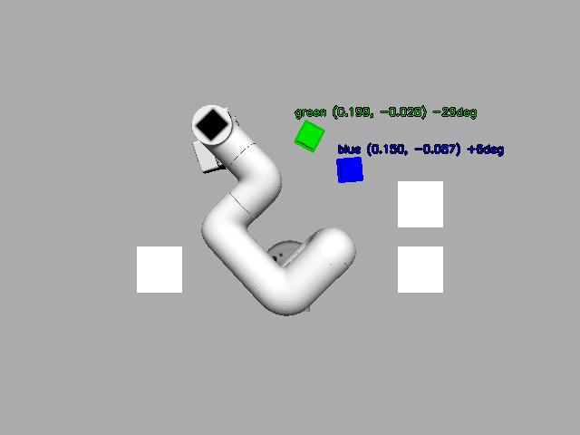
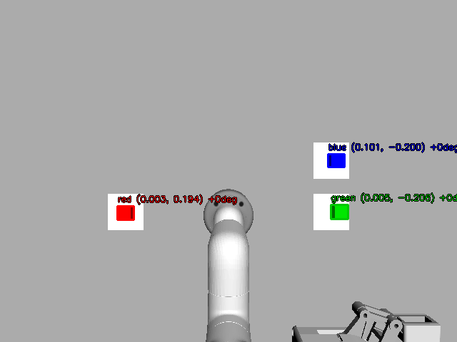
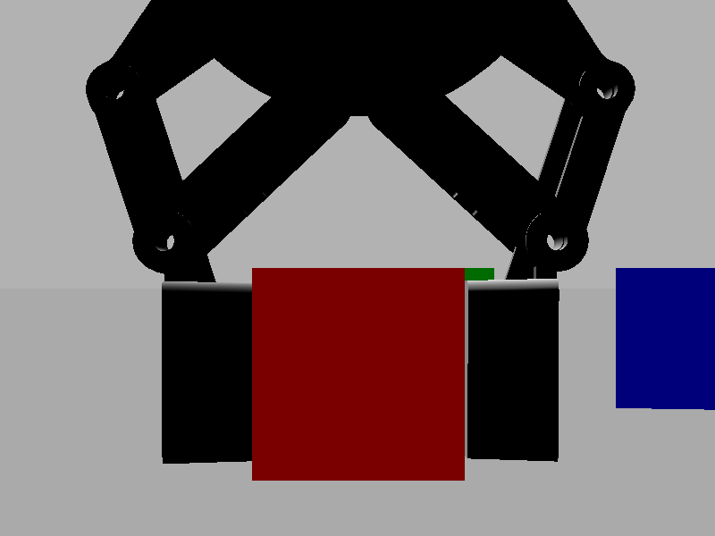

# mycobot_280_vision_pick

Vision-based pick-and-place for the **myCobot 280 M5** in Gazebo (ROS Noetic).

A fixed overhead camera looks down at the table. An OpenCV node finds the coloured
cubes in the image and converts each one to a world position and rotation. A MoveIt
node then picks every cube and places it on the pad of the same colour.

No real robot is needed: everything runs in simulation.

| Before (detector output) | After sorting |
|---|---|
|  |  |

## Run it

```bash
# once
sudo apt install ros-noetic-joint-trajectory-controller ros-noetic-moveit
cd ~/catkin_ws && catkin_make && source devel/setup.bash

roslaunch mycobot_280_vision_pick pick_place.launch
```

This opens Gazebo, RViz (with the detected cubes drawn as markers) and a window
with the annotated camera image, then sorts the three cubes.

| Launch argument | Default | Meaning |
|---|---|---|
| `auto_start` | `true` | Run the pick-and-place sequence automatically |
| `gui` | `true` | Gazebo window |
| `rviz` | `true` | RViz window |
| `image_view` | `true` | Annotated camera image window |

To start the task by hand: launch with `auto_start:=false`, then
`rosrun mycobot_280_vision_pick pick_place.py`.

### Watch it again

The sequence runs once per launch. To replay it without restarting, open a second
terminal (with `source devel/setup.bash`) and run:

```bash
rosservice call /gazebo/reset_world                # puts the cubes back
rosrun mycobot_280_vision_pick pick_place.py       # sorts them again
```

### Troubleshooting

If the launch prints `SpawnModel: Failure - entity already exists` or
`[gazebo-1] process has died`, and the cubes are already on their pads, an earlier
simulation is still running in the background and the new launch attached to it.
Stop everything and launch again:

```bash
killall -9 gzserver gzclient roslaunch rosmaster rviz move_group
```

## How it works

```
Gazebo camera ──image──> cube_detector.py ──MarkerArray──> pick_place.py ──MoveIt──> arm + gripper
                                                                  └──/vision_pick/attach──> gripper_attach_plugin
```

### 1. Detection (`scripts/cube_detector.py`)

1. Convert the image to HSV and threshold it once per colour (red needs two hue
   ranges because it wraps around 0). A saturation threshold rejects the pale pads.
2. Morphological opening removes speckles; `findContours` + `minAreaRect` give each
   cube's pixel centre and edge direction.
3. Each pixel is back-projected onto the plane of the cubes' top face
   (`scripts/vision_geometry.py`):

   ```
   ray_cam   = K⁻¹ · [u, v, 1]ᵀ          (pinhole model, K from /camera/camera_info)
   ray_world = R · ray_cam                (R, t: camera pose from TF)
   p_world   = t + s · ray_world,  s = (z_plane − t_z) / ray_world_z
   ```
4. The yaw comes from one projected edge of the rectangle, folded into ±45°
   because a square looks the same every 90°.

Output: `/vision_pick/cubes` (markers, namespace = colour) and
`/vision_pick/debug_image`.

### 2. Motion (`scripts/pick_place.py`)

For each cube: move above it → straight down → close gripper → attach → lift →
move above its pad → straight down → detach → open → lift. Free-space moves are
planned with OMPL; approach and retreat use Cartesian straight-line paths. Before
reading the camera the arm swings behind its base so it does not block the view.

The floor and a box covering the whole hand are added to MoveIt's planning scene, so
planned motions keep the gripper above the ground (the upstream model only has tiny
collision cylinders on the gripper).

The gripper geometry was measured in Gazebo from background-subtracted silhouettes
(0.09 mm per pixel): the finger pads hang 88-114 mm below the flange, 7.7 mm off its
axis, and the gap between them goes from 42 mm (open) to 17 mm (closed). The measured
gap table is in `pick_place.py`; the gripper is closed to the cube width plus 0.6 mm,
so the pads stop at the cube's faces instead of sinking into them.

### 3. Grasping (`src/gripper_attach_plugin.cpp`)

The upstream model only has tiny collision cylinders at the finger pivots, so the
pads would pass straight through a cube. This package adds a collision box to each
pad (Gazebo copy of the model only, see the xacro). When the gripper closes, the pads
physically push the cube to the centre and square it up, like a real parallel gripper.

Holding the cube by friction alone is unreliable in Gazebo, so, as most Gazebo
pick-and-place demos do, the cube is then welded to the gripper with a fixed joint and
released at the pad. The plugin listens on `/vision_pick/attach` (model name = attach,
empty string = detach).



## Results (simulation)

| Measurement | Result |
|---|---|
| Detection error, position | ≤ 3 mm (vs. Gazebo ground truth) |
| Detection error, yaw | ≤ 6° |
| Placement error on the pad | ≤ 3 mm |
| Pad-to-cube gap when grasped | pads touch, 0.0 mm penetration; cube squared up to the pads within 0.01° |
| Cubes sorted | 3 of 3, repeatable over consecutive runs |

## Tuning

Parameters of `pick_place.py` (private ROS params):

| Parameter | Default | Meaning |
|---|---|---|
| `tcp_offset` | `[-0.0007, 0.0077, 0.101]` | Grasp point (centre of the closed finger pads) in the `joint6_flange` frame (m) |
| `gripper_open` | `0.1` | `gripper_controller` joint value when open (rad) |
| `grasp_clearance` | `0.0006` | Extra pad opening on top of the cube width when grasping (m) |
| `approach_height` | `0.06` | Height above the cube for approach/retreat (m) |
| `place_clearance` | `0.0005` | Gap left under the cube when it is released (m). The cube is set down before the weld is released, so it does not drop |
| `pads` | red `[0, 0.2]`, green `[0, -0.2]`, blue `[0.1, -0.2]` | Drop-off positions (m) |
| `observe_joints` | `[-1.57, 0, 0, 0, 0, 0]` | Arm pose used while the camera looks at the table |

HSV ranges are at the top of `cube_detector.py`. Cube and pad positions are in
`worlds/pick_place.world`; the camera pose is in `urdf/mycobot_280_vision.urdf.xacro`.

## Self-check

```bash
python3 test/test_vision_geometry.py
```

## Known limitations

- The camera is assumed fixed, so its pose is read from TF once at start-up.
- Cubes away from the image centre show a side face as well as the top face, which
  biases the detected centre by a few millimetres.
- The cubes are detected once, before the first pick. Cubes that move afterwards are
  not re-detected.
- The arm is driven by direct position control (no effort PID), so the simulation
  does not model motor dynamics.
- Tested in simulation only, on Ubuntu 20.04 (WSL2) with ROS Noetic and Gazebo 11.

## Credits

The robot model, meshes, MoveIt configuration and mimic-joint plugin come from
Elephant Robotics' [mycobot_ros](https://github.com/elephantrobotics/mycobot_ros)
(`mycobot_description`, `mycobot_280m5_gazebo_gripper`). This package adds the camera,
world, detector, pick-and-place node and attach plugin on top of them.
